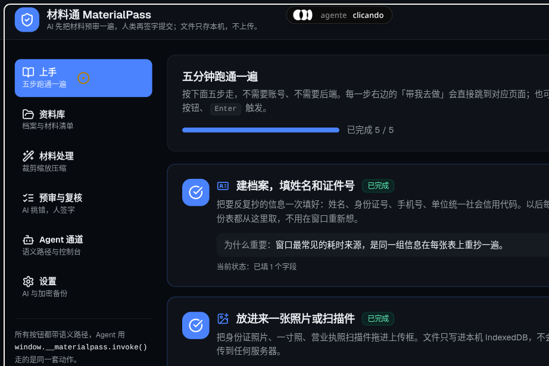
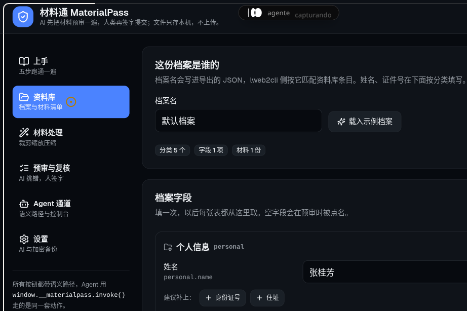
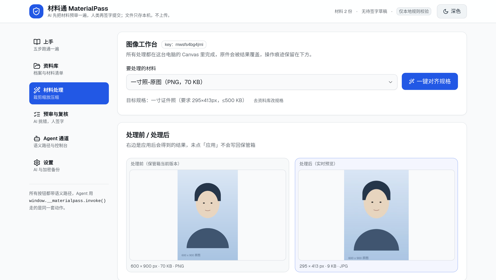
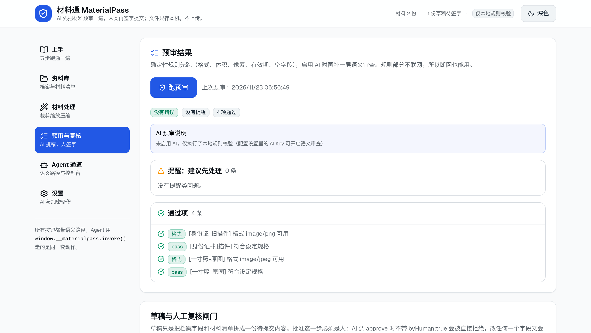
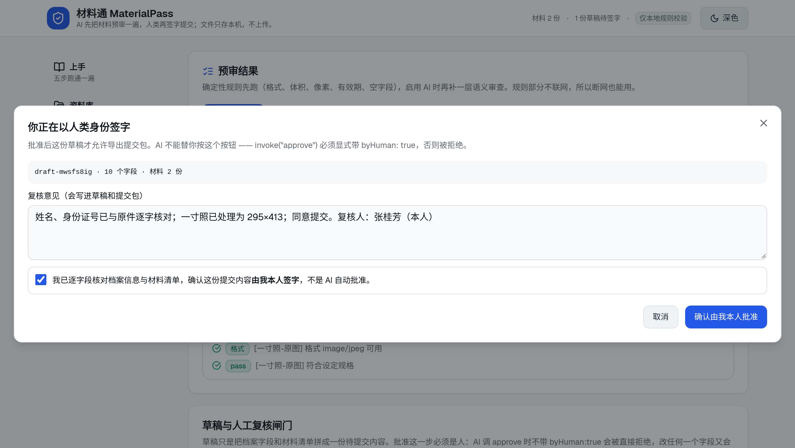
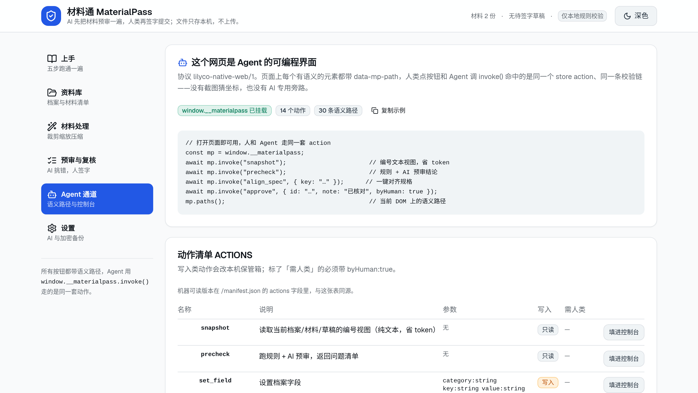
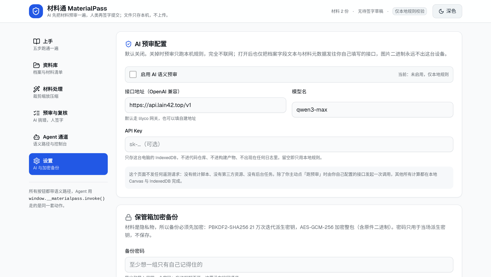

# 材料通 MaterialPass

> **谁在什么场景下用**：去窗口办业务的人（尤其是不会折腾手机的长辈）——把身份证、证件照、证明、合同这些材料集中**保管**起来，一键处理成系统要求的规格，**AI 先预审一遍，人类再签字提交**。

线上地址：<https://github.com/lilyco-42/materialpass> 部署后填入 Qoder Sites 链接

纯前端 SPA，无后端、无账号、无遥测。材料不出本机：图片在浏览器 Canvas 里处理，原件存 IndexedDB，备份导出必须 AES-GCM 加密。

---

## 为什么做

在市场监督管理局窗口看到有人抱着一摞材料慢慢填，反复比对同一组信息：身份证号在每张表上抄一遍，照片因为「超过 100KB」被退回来第三次压缩，扫描件缺了背面又跑一趟。

这件事里真正消耗人的不是"填"，而是三件事：**材料到处散**、**规格看不懂**、**错了要重跑**。

所以材料通的取舍很明确：

- 不做"AI 帮你自动提交"。**提交必须由人类签字**——`approve` 这个动作要求显式带 `byHuman: true`，AI 无法自己批自己的材料。
- 做**预审**而不是代填：把"这张照片像素不对""这个证件还有 20 天过期""这三个字段是空的"在人按提交键之前说清楚。
- 做**互通**而不是重造：跨站点真正填报的引擎在 [`lilyco-web2cli`](https://github.com/lilyco-42/lilyco) 里已经有了（vault 资料库、CDP 附着已登录浏览器、wizard 向导、HumanReviewGate）。材料通负责让人看得懂、改得动，导出的资料库 JSON 与 `VaultProfile` 逐字段一致，已由真实 `lweb2cli vault --op import` 导入验证；草稿对齐字段命名与 `status` 取值，CLI 侧带 `command` 的填报草稿由 `prepare-submit` 生成。

## 怎么用（5 步，评委照着就能跑通）

1. **建档案** — 资料库页填姓名、证件号、联系方式，一次填完，以后所有表都从这里取。空着就点「载入示例档案」。
2. **放材料** — 拖一张证件照或扫描件进来，给它选一个目标规格（一寸照 / 身份证 / 营业执照…），登记有效期。
3. **对齐规格** — 点「一键对齐」：比例不对会居中裁切，尺寸不对会缩放，体积超标会先降质量、再降分辨率。每一步操作痕迹都留在日志里，可回看。
4. **跑预审** — 先看本地规则（格式/体积/像素/有效期/空字段），再可选开启 AI 做语义审查（姓名是否各处一致、材料是否互相矛盾、是否缺关键页）。问题清单每条都能点回对应材料。
5. **人工签字** — 生成草稿，逐字段核对，点「批准」并写复核意见（会弹二次确认，明确"你正在以人类身份签字"）。只有 `approved` 的草稿才能导出提交包。

## AI 原生：这个网页可以被 Agent 直接操作

这是它跟"套壳表单"最大的区别。页面每个有语义的元素都挂 `data-mp-path`，并且**人类点按钮和 Agent 调 `invoke()` 走的是同一套 action、同一条校验链**——不存在 Agent 专用旁路，也没有平行状态。

```js
// 浏览器控制台 / 任何 Agent，打开页面即可
const mp = window.__materialpass;

mp.invoke("snapshot");                                  // 编号文本视图，低 token 成本
mp.invoke("precheck");                                  // { errors, warns }
mp.invoke("align_spec", { key: "m1" });                 // 一键对齐规格
mp.invoke("create_draft", { base_url: "https://…" });   // 生成待审草稿
mp.invoke("approve", { id: "draft-x", note: "已核对", byHuman: true });
mp.invoke("export_vault_lweb2cli");                      // 交给 lweb2cli 复放填报
mp.paths();                                              // 当前所有语义路径
```

机器可读契约在 [`public/manifest.json`](public/manifest.json)：动作、参数、是否写入、是否需要人类、语义路径命名规范全在里面。详见 [`docs/AI-NATIVE.md`](docs/AI-NATIVE.md)。

对 Agent 不友好（只有像素、没有语义）的网页，Agent 只能截图猜坐标，猜错就提交错材料。材料通把语义路径作为一等公民，正是政务场景最需要的：**可验证、可复放、且人类随时能接管**。

## 隐私

| 事项 | 做法 |
|---|---|
| 材料上传 | 没有任何上传。文件只进本机 IndexedDB |
| 图片处理 | 全部在浏览器 Canvas 完成 |
| 备份导出 | PBKDF2-SHA256 210k 轮 + AES-GCM-256，密码不离开本机 |
| AI 预审 | 默认关闭。开启时只把**字段文本与材料元数据**发给你自己填的 API，绝不发图片二进制 |
| API Key | 只存本机，不进仓库、不进构建产物 |
| 遥测 | 零。没有统计脚本、没有第三方请求 |

## 开发

```bash
pnpm install
pnpm dev       # 本地开发
pnpm build     # 类型检查 + 生产构建 → dist/
```

栈：React 19 + Vite 6 + Tailwind v4（lilyco 官方 `lilyco-template/web` 底座，shadcn oklch 令牌）。

```
src/lib/
  types.ts   VaultProfile 与 lilyco-web2cli 逐字段一致；SubmissionDraft 对齐字段命名与 status
  specs.ts   政务材料规格库 + 确定性规则引擎
  imaging.ts 旋转/裁剪/缩放/压缩/转格式（Canvas）
  crypto.ts  保管箱加密备份（PBKDF2 + AES-GCM）
  store.ts   唯一状态源 + 全部 action（人类与 Agent 共用）
  native.ts  lilyco-native-web/1 协议桥
  ai.ts      AI 语义预审（可选，失败自动回退规则）
```

## 与 lilyco-web2cli 互通（实测）

网页「导出 lweb2cli 互通资料库」产出的 JSON，直接喂给真实 CLI：

```bash
lweb2cli vault --op import --profile materialpass --file materialpass-vault.json
# {"imported":true,"profile":"materialpass","categories":["company","contact","finance","legal_rep","personal"],"attachments_count":2}
```

跨站点填报那一头由 CLI 承担：`prepare-submit --source <url> --profile <名>` 生成带 `command` 的
待审草稿 → `review --op approve` 人工签字 → `commit-submit --id <draft>` 受控发包。
网页草稿对齐的是字段命名与 `status` 取值，它记录的是"人签过字"这件事，本身不带目标站点命令规格。

## 截图

以下均为生产构建（`pnpm build` 后的 `dist`）在无头 Chromium 里的实机截图，1440×900。
**画面里的姓名、证件号、材料都是脚本生成的虚构示例数据**，不是任何真实个人信息。

| 上手五步 | 资料库 | 材料处理（前 → 后） |
| --- | --- | --- |
|  |  |  |

| 预审结果 | 人工签字闸门 | 签字后放行导出 |
| --- | --- | --- |
|  |  |  |

| Agent 通道 | 设置 |
| --- | --- |
|  |  |

处理前后那一组是真实结果：600×900 的 PNG 原图，按「一寸证件照」规格居中裁切后缩放到 295×413、
转 JPEG、70 KB → 9 KB；「一键对齐」与页面右侧的实时预览共用同一份 `specTransform()`，所以预览即结果。

## Qoder 开发过程

**交给 Qoder 的**：需求预研（含"大赛真正要求的是 Qoder Sites 公开链接 + 天池作品帖，而不是 GitHub"这一纠正、
以及发现 `lilyco-web2cli` 已实现填报引擎、于是改为资料库格式逐字段互通而不是重写）；技术栈对齐官方
`lilyco-template/web`；`src/lib/` 数据层与 `lilyco-native-web/1` 协议桥；六个页面的 UI；
用本机 ego-lite 浏览器跑完整端到端流程并截图。

**Qoder 自己发现并修掉的缺陷**（都是实跑出来的，不是事先想到的）：

1. `app.tab.vault` 命中 2 个元素——响应式侧栏与窄屏导航共用了同一路径，Agent 会定位失败。
   改为窄屏独立命名空间 `app.tabbar.*`，并新增 `ambiguous()` 自检动作，让页面自己报告歧义地址。
2. 缩放日志把「从 → 到」打成同样的数值（先赋值再拼字符串）。
3. 材料处理页的「处理后（实时预览）」没有带上目标规格的像素尺寸，导致预览显示 600×900 而
   一键对齐实际产出 295×413——预览与结果不一致。抽出 `specTransform()` 供 store 与页面共用后修复。
4. 390px 手机视口下 Agent 页把整页撑到 1020px 宽——长 JSON 示例与语义路径列表作为网格子项按
   `min-width:auto` 取了自己的最小内容宽度。给卡片与示例块加 `min-w-0`、代码块在自己盒子里滚动后，
   六个页面 `scrollWidth` 全部回到 390；并补了 `@media (pointer: coarse)` 让触屏点击目标 ≥44px。

**人工决定的**：不做"AI 自动提交"这条产品红线（`approve` 硬要求 `byHuman: true`）；
规格数值不做官方标准宣称、全部可编辑；赛道选择；无障碍与文案取向；品牌命名。

## 许可

MIT，见 [LICENSE](LICENSE)。属于 [lilyco](https://github.com/lilyco-42/lilyco) 生态。
